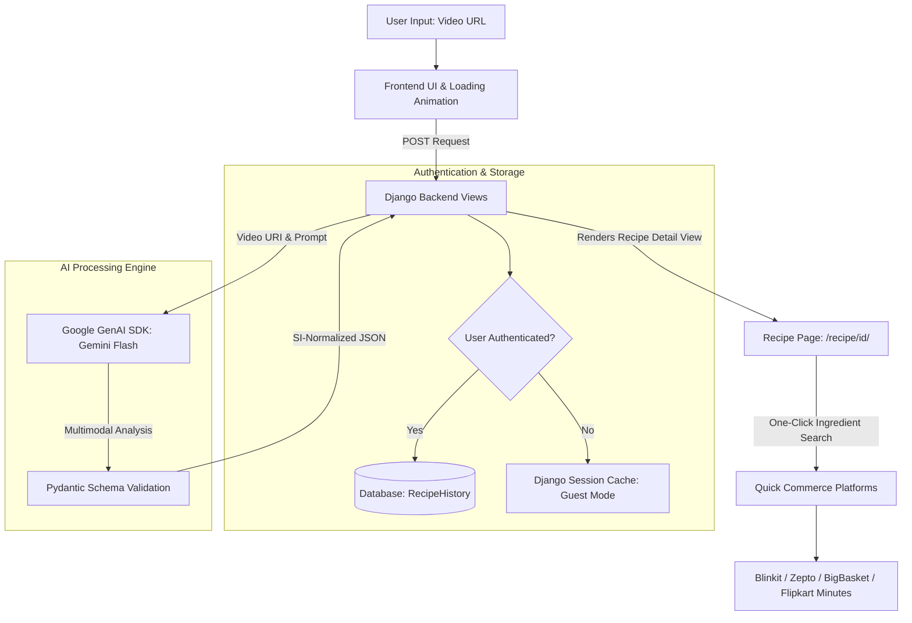

# Reel To Meal: AI-Powered Recipe Extraction & Quick-Commerce System

**Live Deployment:** [https://reeltomeel.pythonanywhere.com/](https://reeltomeel.pythonanywhere.com/)

## 📌 Project Overview
**Reel To Meal** is a full-stack Django web application designed to bridge the gap between short-form/long-form cooking videos and actionable culinary execution. Powered by Google's **Gemini Flash** multimodal AI, the system processes cooking video links (such as public YouTube videos) and automatically extracts structured recipes—complete with **SI-unit normalized ingredients**, **required kitchen instruments**, **serving sizes**, and **step-by-step instructions**.

To turn inspiration into action seamlessly, every extracted ingredient features an integrated **Ingredients & Quick Buy** panel that redirects users directly to live search results on major quick-commerce platforms: **Blinkit**, **Zepto**, **BigBasket**, and **Flipkart Minutes**.

## 👥 Contributors
* **Shubham Mandal** `[2351129]`
* **Shreya Yadav** `[2351162]`
* **Lalit Snadhu** `[2351192]`
* **Marbi Bala** `[2351193]`

## 🛠 Technical Stack
* **Backend:** Python, Django
* **AI Model & SDK:** Google Gemini Flash (`google-genai` SDK)
* **Data Validation:** Pydantic (Structured JSON schema enforcement)
* **Database:** SQLite (Development) / PostgreSQL (Production-ready)
* **Frontend:** HTML5, Tailwind CSS, Vanilla JavaScript
* **Environment & Security:** `python-dotenv` (`.env` secret management), CSRF protection

## ⚙️ Key Features
1. **Multimodal Video Extraction:** Processes video URLs directly using the `google-genai` SDK (`types.Part.from_uri`) to analyze both visual cues (kitchen tools and techniques) and spoken instructions.
2. **Strict SI Unit Normalization:** Uses Pydantic response schemas (`RecipeSchema`) to guarantee clean JSON output and convert all imperial/colloquial measurements (cups, oz, lbs, tbsp) into standard SI units (grams, milliliters, °C).
3. **Ingredients & Quick Buy (Quick-Commerce Redirects):** Every extracted ingredient card includes one-click, color-coded redirect buttons for **Blinkit**, **Zepto**, **BigBasket**, and **Flipkart Minutes**, opening the platform's search results pre-filled with that exact ingredient.
4. **Dedicated Recipe View (`/recipe/<id>/`):** Clean two-column layout displaying the recipe title, a direct **Watch Original Video** link, a **Serving Size** badge, **Instruments Needed** tags, **Ingredients & Quick Buy** cards, and numbered **Instructions**.
5. **Custom Authentication & Guest Mode:**
   * **Guest Mode:** Instant login-less usage with temporary history stored in Django's session cache.
   * **User Accounts & Dashboard:** Custom-styled raw HTML Login and Sign Up flows processed in Django views, giving authenticated users a persistent **Dashboard** of their saved recipe history.
6. **Minimalist Animated UI:** Gradient-based interface styled with Tailwind CSS, featuring smooth card transitions and an interactive SVG loading spinner during AI processing.
7. **Environment Variable Security:** Sensitive credentials (`GEMINI_API_KEY`, `SECRET_KEY`, `DEBUG`) are isolated in a `.env` file and excluded from version control via `.gitignore`.

## 🏗 System Architecture


## 🚀 Installation & Local Setup

1. **Clone the Repository:**
```bash
git clone https://github.com/Shubham-Mandal-sudo/ReelToMeal.git
cd ReelToMeal

```


2. **Initialize Virtual Environment:**
```bash
python -m venv venv
source venv/bin/activate  # On Windows: venv\Scripts\activate

```


3. **Install Dependencies:**
```bash
pip install -r requirements.txt

```


4. **Configure Environment Variables:**
Create a `.env` file in the root directory (alongside `manage.py`):
```env
GEMINI_API_KEY=your_actual_gemini_api_key_here
SECRET_KEY=your_django_secret_key_here
DEBUG=True

```


5. **Run Database Migrations:**
```bash
python manage.py makemigrations
python manage.py migrate

```


6. **Start the Development Server:**
```bash
python manage.py runserver

```


Visit `http://127.0.0.1:8000/` in your browser.

## 📊 Database Schema (`RecipeHistory`)

| Field | Type | Description |
| --- | --- | --- |
| `user` | `ForeignKey(User)` | Links the saved recipe to an authenticated Django user |
| `video_url` | `URLField` | Original cooking video link |
| `recipe_name` | `CharField` | Extracted title of the dish |
| `recipe_data` | `JSONField` | Structured JSON containing SI ingredients, instruments, serving size, and instructions |
| `searched_at` | `DateTimeField` | Timestamp when the recipe was extracted |

## 🛣 Key Routes

* `/` — Home page & video URL extraction form
* `/recipe/<id>/` — Detailed recipe view with Quick Buy links
* `/dashboard/` — Authenticated user's saved recipe history
* `/login/` & `/signup/` — Custom HTML authentication pages
* `/logout/` — Secure POST-based logout

## 📝 License

This project was developed for academic purposes at **Heritage Institute of Technology** as part of the **Project - I [CSE3295]** curriculum.
